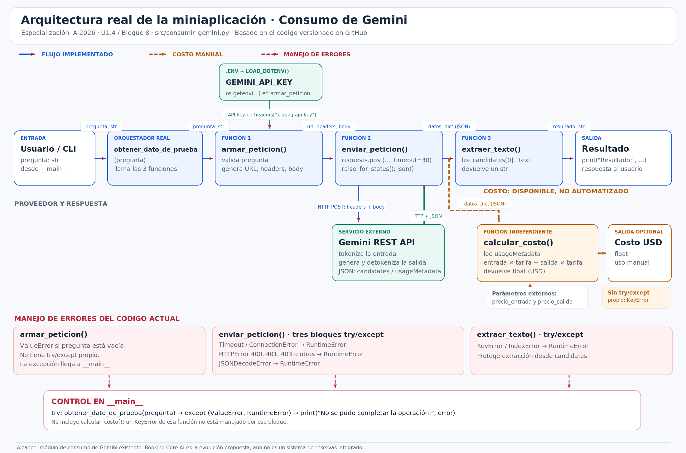

# ADR-001 — Selección de modelo generativo para la miniaplicación

**Programa:** Especialización en Desarrollo con IA Generativa 2026 · Skillnest / Accenture / CChIA  
**Unidad y actividad:** U1.4 · Bloque 9 · «Documenta tu decisión de arquitectura en el repositorio» (Core)  
**Fecha de decisión y mediciones:** 20 de octubre de 2026 (Chile, UTC−03:00)  
**Estado:** Decisión de referencia para el prototipo; implementación del cambio y validación de salida estructurada pendientes.  
**Alcance:** módulo actual de consumo de Gemini (`src/consumir_gemini.py`) y caso de evolución «Booking Core AI», intérprete de solicitudes de reservas mediante IA. No representa un motor de reservas operativo.

## 1. Modelo elegido

**Modelo seleccionado: `gemini-3.5-flash-lite` (Google Gemini API).**

Se elige como **modelo de referencia para el prototipo Booking Core AI** por su relación observada entre corrección de las respuestas, costo y latencia. El cambio de modelo en el módulo productivo **todavía no está implementado**: al registrar este ADR, la función `armar_peticion()` de `src/consumir_gemini.py` continúa configurando `gemini-3.8-flash`. La comparación se ejecutó modificando el endpoint de cada petición únicamente desde los scripts de medición.

**Condición de integración:** antes de usar la salida en lógica de negocio, exigir JSON estructurado y validación de esquema/valores (incluida la necesidad de aclaración). El modelo solo interpreta solicitudes; no consulta disponibilidad ni confirma reservas.

## 2. Diagrama de arquitectura

El siguiente diagrama corresponde al **módulo Python efectivamente implementado** durante el Bloque 8. Muestra las funciones `armar_peticion`, `enviar_peticion` y `extraer_texto`; el origen de `GEMINI_API_KEY` en `.env`; excepciones; la respuesta `usageMetadata`; y `calcular_costo()` como función independiente que aún no se invoca desde el flujo principal.



**Archivos relacionados:** [diagrama PNG](diagrama_arquitectura.png) · [fuente editable draw.io](diagrama_arquitectura_u14.drawio) · [módulo en GitHub](https://github.com/nicolasbellov/especializacion-ia-2026/blob/main/src/consumir_gemini.py).  
**Evidencia del diagrama versionado:** [commit 61541fe](https://github.com/nicolasbellov/especializacion-ia-2026/commit/61541fe).

### Flujo resumido

1. La aplicación recibe una pregunta y llama a `obtener_dato_de_prueba(pregunta)`.
2. `armar_peticion()` valida texto, construye URL/cuerpo y agrega el header `x-goog-api-key` a partir de `GEMINI_API_KEY` cargada desde `.env`.
3. `enviar_peticion()` realiza la petición HTTPS POST a Gemini y devuelve JSON; usa bloques `try/except` para condiciones de conexión, timeout, error HTTP y JSON inválido.
4. `extraer_texto()` recupera el texto de `candidates[0]`; si faltan campos/listas, convierte `KeyError`/`IndexError` en `RuntimeError`.
5. El bloque principal gestiona `ValueError` y `RuntimeError` para el flujo actual; la función `calcular_costo()` puede leer `usageMetadata` en una llamada independiente, pero **no** está integrada automáticamente al retorno de `obtener_dato_de_prueba()`.

## 3. Comparación de candidatos (datos reales)

**Modelos y fecha de benchmark:** 20/10/2026; `gemini-3.5-flash-lite` y `gemini-3.8-flash`.  
**Fuente de tarifas estándar de pago por uso:** [Google AI for Developers — Gemini API Pricing](https://ai.google.dev/gemini-api/docs/pricing), consultada el 20/10/2026.  
**Fuente de mediciones y respuestas completas:** [`mediciones_modelos_u14.csv`](mediciones_modelos_u14.csv) (12 observaciones, timestamps, casos, tokens, costo y respuesta).  
**Nota:** los precios son tarifas publicadas y los costos son **estimaciones reproducibles** de consumo a tarifa de pago por uso; no se afirma que sean cargos efectivamente facturados a la cuenta.

| Criterio | Gemini 3.5 Flash-Lite (elegido) | Gemini 3.8 Flash (alternativa) |
|---|---:|---:|
| **Tarifa entrada / 1.000 tokens** | USD 0,00030 | USD 0,00075 |
| **Tarifa salida / 1.000 tokens (incluye razonamiento)** | USD 0,00250 | USD 0,00375 |
| Tarifa entrada / 1 millón de tokens | USD 0,30 | USD 0,75 |
| Tarifa salida / 1 millón de tokens | USD 2,50 | USD 3,75 |
| Mediciones completadas | 6 de 6 | 6 de 6 |
| **Latencia media, reserva completa (4 repeticiones)** | **2.468 s** | **7.837 s** |
| Mediana de latencia, reserva completa | 2.367 s | 5.741 s |
| **Costo medio estimado, reserva completa** | **USD 0.00021540** | **USD 0.00217819** |
| Tokens de entrada por reserva completa | 143 | 143 |
| Tokens de salida visible, promedio de 4 | 69.00 | 65.25 |
| Tokens de razonamiento, promedio de 4 | 0 | 487 |
| **Respuestas semánticamente correctas en los escenarios de prueba** | **6/6** | **6/6** |
| **Respuestas JSON parseables directamente** | **0/6** | **5/6** |

**Diseño experimental:** se utilizó el mismo prompt y el mismo caso `reserva_completa` en cuatro repeticiones por modelo, más un caso `hora_imprecisa` y otro `cancelacion_sin_id` por modelo. Se midió el tiempo HTTP de cada llamada con `time.perf_counter()`. Los 12 registros corresponden a **3 escenarios distintos**, no a 12 escenarios de cobertura funcional. Los modelos se midieron de manera secuencial, no simultánea.

**Criterios de calidad por escenario:**

- `reserva_completa`: intención `crear_reserva`, fecha `2026-10-24`, hora `19:30`, 2 personas, `requiere_aclaracion=false`.
- `hora_imprecisa`: intención `crear_reserva`, fecha `2026-10-25`, 3 personas, hora `null`, `requiere_aclaracion=true`.
- `cancelacion_sin_id`: intención `cancelar_reserva`, fecha/hora/personas `null`, `requiere_aclaracion=true`.

**Hallazgo de formato:** Flash-Lite devolvió 6/6 respuestas semánticamente correctas, pero todas encapsuladas entre delimitadores Markdown (` ```json `), por lo que no son directamente parseables con `json.loads()` sin tratamiento adicional. Flash devolvió 5/6 como JSON directamente parseable. Separamos expresamente **calidad semántica** de **conformidad del formato de integración**.

**Costeo:** para cada respuesta se usaron tokens de entrada, tokens visibles de salida y tokens de razonamiento (`thoughtsTokenCount`). Ninguna medición registró tokens de caché. Una implementación de facturación más completa debe revisar modalidades de tarifa, caching, cambios de precio, cuotas y demás componentes cobrables.

**Proyección ilustrativa:** para 100.000 peticiones mensuales de tipo `reserva_completa` con consumo medio constante y tarifas actuales, el costo estimado sería **USD 21.54** con Flash-Lite frente a **USD 217.82** con Flash; diferencia de **USD 196.28** al mes. No incluye infraestructura, almacenamiento, otros endpoints ni efectos de variaciones de carga.

**Vigencia de tarifas:** el precio de Gemini 3.8 Flash es introductorio hasta el **31/12/2026**, y Google anuncia otras tarifas desde el 01/01/2027; las proyecciones deben actualizarse antes de presupuestar períodos posteriores.

## 4. Justificación de la elección

Para interpretar solicitudes simples de reserva, el requisito principal del prototipo es extraer **intención, fecha, hora, cantidad de personas y necesidad de aclaración**, sin inventar disponibilidad ni ejecutar reservas. En los tres escenarios definidos, **ambos modelos coincidieron con los resultados esperados**; no se observó una ventaja semántica de Flash que compensara sus costos en esta muestra.

Con cuatro peticiones idénticas de reserva completa por modelo, Flash-Lite fue aproximadamente **3.18 veces más rápido** (latencia media 2.468 s contra 7.837 s) y **10.11 veces menos costoso** para esa carga (USD 0.00021540 frente a USD 0.00217819). Por ello, costo y latencia son factores decisivos **una vez cumplida la calidad semántica mínima**.

La elección se adopta **para el prototipo, no como autorización de despliegue productivo**. El problema de formato JSON es una condición explícita que debe resolverse mediante salida estructurada cuando esté disponible, validación de esquema y pruebas negativas. Se deberá ampliar el conjunto de casos antes de utilizar el modelo en operaciones reales.

## 5. Alternativa descartada y por qué

**Alternativa no seleccionada: `gemini-3.8-flash`.** Se descarta **para la primera versión del intérprete de reservas**, no por insuficiencia técnica: acertó en los tres escenarios y presentó mejor conformidad de JSON directo (**5/6** frente a **0/6**). Sin embargo, en las cuatro llamadas equivalentes tuvo mayor latencia y consumo económico, sin una mejora de exactitud semántica observada que justifique la diferencia para esta tarea concreta.

Se registraron respuestas HTTP **503** al intentar completar algunas mediciones de Flash; el reintento posterior permitió reunir las 12 observaciones. **No** se interpreta ese episodio como una tasa de disponibilidad ni como una prueba concluyente de que Flash es menos confiable, porque las fallas no fueron parte de una evaluación de fiabilidad con muestras comparables.

**Revisión futura de la decisión:** reconsiderar Flash u otro candidato si la extracción se vuelve más compleja, Flash-Lite falla casos críticos, aparece una mejora comprobada de precisión o cambian precios/latencias/cuotas. Una optimización posterior podría evaluar el presupuesto de razonamiento y el modo de salida JSON estructurada bajo condiciones equivalentes.

---

### Evidencia, límites y próximos pasos

- **Evidencia entregada:** `docs/diagrama_arquitectura.png`, `docs/diagrama_arquitectura_u14.drawio`, `docs/mediciones_modelos_u14.csv` y este `docs/decision-arquitectura.md`.
- **Reproducibilidad local:** scripts `src/comparar_modelos_u14.py` y `src/reanudar_comparacion_u14.py` (en el entorno de trabajo; comprobar su versionamiento antes de afirmar que están publicados).
- **Límites del experimento:** cuatro repeticiones comparables de una sola solicitud; tres escenarios en total; salida sin contrato JSON estricto; mediciones en un único día/entorno; variación de latencia y fallas HTTP transitorias.
- **Pendientes de implementación:** configurar el modelo recomendado sin alterar inadvertidamente otras funciones; definir JSON estructurado y validación; ampliar pruebas con datos relativos, fechas inválidas, reservas ambiguas, cancelaciones incompletas y errores de API; controlar límites y reintentos; revisar precios antes de nuevas fases.
- **Seguridad:** no incluir la clave real de `.env` en Git; el documento solo identifica `GEMINI_API_KEY` por su nombre de variable de entorno.

**Trazabilidad académica:** U1.4, Bloque 8 (diagrama), Bloque 9 (comparación y registro de decisión). El documento constituye una decisión de diseño fundamentada y verificable; su commit/push y entrega a Skillnest deben confirmarse por separado.
