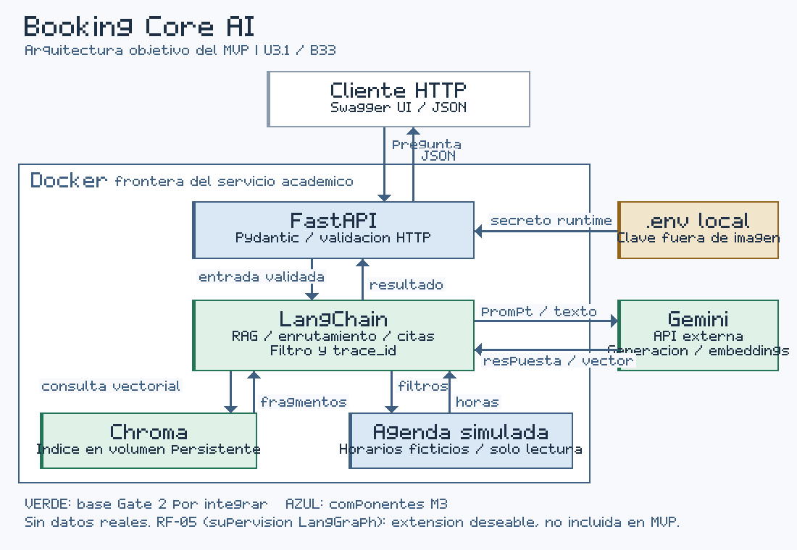

# Ficha de Diseño Funcional

Proyecto: **Booking Core AI** · Especialización IA 2026 · Perfil de referencia: Backend / Integración de APIs.

## 1. Problema de negocio
El personal encargado de atender clientes de una barbería ficticia responde manualmente consultas recurrentes sobre servicios, disponibilidad de horarios y políticas de reserva, cancelación y reprogramación. Debe revisar las políticas y la agenda, lo que interrumpe su trabajo y puede producir respuestas inconsistentes. Se considera un volumen de 30 consultas semanales y 3 minutos por consulta (estimación académica, no datos reales), equivalente a 90 minutos semanales de atención repetitiva. Se espera obtener respuestas fundamentadas y consistentes en menos de un minuto por consulta, identificando explícitamente los casos en que no existe información suficiente.

## 2. Requerimientos y alcance (MVP)
### Requerimientos funcionales
- RF-01: Responder preguntas de texto mediante un endpoint HTTP con salida estructurada en JSON.
- RF-02: Incluir al menos una referencia al documento pertinente en cada respuesta documental fundamentada.
- RF-03: Abstenerse de afirmar información cuando no exista evidencia suficiente, incluyendo precios y horarios reales desconocidos.
- RF-04: Consultar horarios disponibles de una agenda ficticia mediante datos transaccionales simulados, identificándolos explícitamente como ficticios.
- RF-05: Gestionar la aprobación o rechazo humano previo a una cancelación ficticia, sin efectuar operaciones reales.
- RF-06: Consultar información transaccional de Booking Core productivo.
- RF-07: Mostrar el historial conversacional en una interfaz web propia.
### Requerimientos no funcionales
- RNF-01: Al menos 9 de 10 consultas documentales del conjunto de prueba con Gemini real responden en menos de 20 segundos, medidos de extremo a extremo por HTTP con el índice previamente cargado.
- RNF-02: En los logs de 10 consultas de prueba, 0 líneas contienen la pregunta completa, documentos completos o credenciales; se verificará con entradas y secretos ficticios controlados.
- RNF-03: Al menos 9 de 10 respuestas del conjunto documental etiquetado citan una fuente pertinente cuyo contenido respalda la afirmación, contrastada con el corpus original.
- RNF-04: Las 10 de 10 consultas válidas del conjunto de prueba tienen un trace_id único y correlacionable entre la respuesta HTTP y el registro de aplicación.
- RNF-05: En 1 instalación limpia de referencia con Docker operativo y acceso a dependencias, el servicio se construye e inicia hasta responder una comprobación de salud en menos de 15 minutos siguiendo el README.
### Alcance
Imprescindible: RF-01, RF-02, RF-03, RF-04

Deseable: RF-05 (solo con presupuesto adicional; si se incluye, la aprobación es obligatoria antes de cancelar).

Fuera de alcance: RF-06 (requiere sistemas y datos reales), RF-07 (frontend propio no necesario para demostrar el servicio).

**Presupuesto provisional:** 24 horas totales de laboratorio y evidencia, no disponibilidad confirmada; 12 h construcción, 7,2 h pruebas/documentación/defensa y 4,8 h imprevistos. Los imprescindibles y T-DOCKER (trabajo asociado a RNF-05) suman 11 h ajustadas; queda 1 h de holgura de construcción. RF-05 añade 3 h y solo cabe a partir de un escenario de 28 h totales. Se reutiliza [el presupuesto validado en Windows](../presupuesto/presupuesto_booking_core.py), con factor 1,5 para novedad. Los RNF son objetivos pendientes de medición, no resultados alcanzados. Confirmar horas reales antes de cerrar la planificación.

## 3. Arquitectura de la solución
Diagrama: docs/diagrama_arquitectura.png

- Modelo: Gemini mediante API externa para generación y embeddings compatibles con el índice Gate 2; la clave se suministra desde .env local al entorno de ejecución, nunca se incorpora a la imagen.
- Vector store: Chroma con índice académico persistente (5 documentos ficticios, 10 chunks en Gate 2, k=3), montado como volumen de Docker y reutilizado sin reindexar en cada consulta.
- Orquestación: LangChain reutiliza recuperación, filtro de inyección, generación con citas y trazabilidad de Gate 2; el enrutamiento a Agenda simulada será determinista para datos transaccionales ficticios, sin inventar disponibilidad ni consultar producción.
- Exposición: FastAPI con Pydantic recibe consultas de Cliente HTTP (Swagger UI o cliente de pruebas) y devuelve JSON validado, incluyendo estado, fuentes cuando corresponda y trace_id.
- Empaquetado: Docker delimita el servicio académico y monta el índice persistente, con configuración y secretos externos; permite construir y ejecutar el servicio de manera reproducible.

**Estado y límites:** arquitectura objetivo M3, no implementación ya validada. Se reutilizarán [ServicioRAG](../gate2/servicio.py), [índice](../gate2/indice.py), prompt v3-gate2 y controles existentes. Agenda simulada se implementará con datos sintéticos de solo lectura. Las consultas reales desconocidas se abstienen incluso cuando haya datos simulados. La supervisión mediante [LangGraph](../gate2/supervision.py) se conserva como extensión deseable RF-05, no como componente requerido del diagrama MVP. La verificación sintáctica de citas y el detector de patrones de inyección no garantizan seguridad ni respaldo semántico universal. No existe integración productiva, autenticación productiva ni aislamiento multi-tenant acreditado; no se conectará ni modificará Booking Core real.

## 4. Criterios de aceptación
[PENDIENTE: se completa en el Bloque 34]

## 5. Plan de construcción por hitos
[PENDIENTE: se completa en el Bloque 34]
